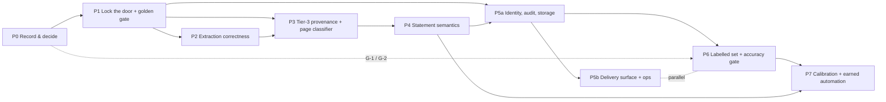
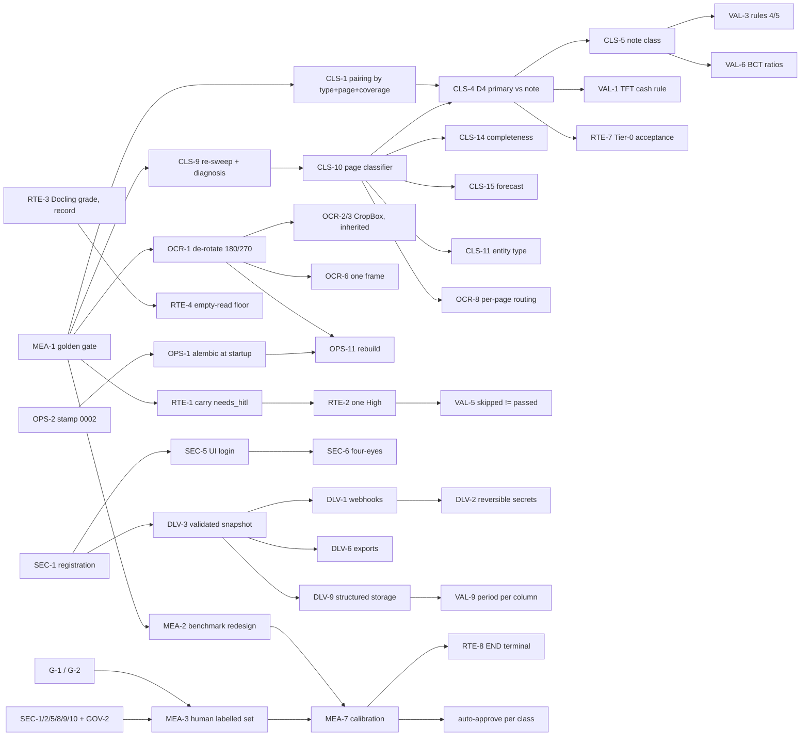

# FinAIze — Master Plan

> [!abstract] What this is
> One document that holds **every issue found by the 2026-09-11 review** (security, OCR, classification, validation, routing,
> delivery, UI, governance, ops, measurement, docs, scope), the order in which to fix them, and the gates between phases.
> It is **proposed**: the decisions it depends on are collected in [[Decision-Form]]; deferred items live in [[Project-Backlog]].
> Nothing in it has been implemented. Code changes start only when the form comes back.

## 1. Status and source authority

| | |
|---|---|
| Code | branch `feat/hitl-ui-flags`, HEAD `3e7dd98` — P1 merged 2026-09-18 (WP-1.0 ab8b13b … WP-1.2 262d42b); P2 merged 2026-09-19: WP-2.5 4695cfa, WP-2.1 8c5c108, WP-2.9 8dd28d4, WP-2.2 bf6967f, WP-2.10 a977f9d, WP-2.3 ec9231d, WP-2.11 60f4cc8, WP-2.6 e0bb91f, WP-2.9b 176f34b, WP-2.4 a24d26d, WP-2.7 a52d1b8, WP-2.8 eca576a, WP-2.12 e662dd8 (docs commits and golden baselines in between); not pushed since 2e6997d, not merged to `main` |
| Tests | 703 passed at HEAD (`venv/Scripts/python -m pytest -q`) |
| Golden baseline | `tools/golden/baseline-eca576a.json` (current; earlier baselines kept as phase records: 687165b P1, then 4695cfa, 8dd28d4, a977f9d, 60f4cc8, e0bb91f …); every P2 merge was validated by a re-snapshot against the preceding baseline with its `expected/<wp>.yaml` |
| Prod | runs code older than `57bacb9`; compose bakes `src/` into the images, so a `docker compose up --build` is required (with the Alembic step in OPS-1/2) |
| Corpus | 17 sample files, 16 distinct (the two `EF CLB 2024 Provisoire (1).pdf` copies are byte-identical); 9 PDF, 6 DOCX, 1 JPG; 12 distinct entities |
| Last full sweep | 2026-08-14 (`scratchpad/sweep_results.jsonl`) — **predates** `27db4b0` and `d42309c`; fis_innov's row is stale (0.642 recorded, 0.342 at HEAD) |
| Review | workflows `wf_dd11ab31-84b` (9 agents: OCR root cause + scope/vision), `wf_60ce2646-d09` (3 evidence sweeps), `wf_0258a168-b13` (4 adversarial critiques, 106 claims fact-checked) |

**Source-authority legend** — every row and every claim carries one or more tags:

| Tag | Meaning | Treatment |
|---|---|---|
| **O** | Owner-authored: spec v0.5 (2025-11-09), Canva deck V.0.1 (2026-02), control-rules docx (2025-12-02; green highlights = the owner's selection) | Current as of its date; [[Decision-Form]] asks the owner to confirm each is still current |
| **R** | Regulation / standard: BCT circulars, laws, NC 01/16/21…, Code des sociétés commerciales | Authoritative; secondary-source caveats kept |
| **M** | Measured at HEAD `d42309c`: `file:line`, sweep, corpus counts, probes | Authoritative until the code changes |
| **T** | Team-authored design docs (`Vision-and-Architecture-Directions` 2026-05-30, `Decision-Support…`, `PoC-Experimentation-Plan`, `Scoring-Approach-Analysis`, `Skill-Suite-Roadmap`, `Research-*`, `resource0/1`, `OCR-Engine-Benchmark-Matrix` June 2026) | **Suggestions unless confirmed** in the form's checklist; T-only numbers are re-measured before use |
| **P** | Proposals: [[Scope-Answers-Proposed]], [[Known-Gaps-Unit-Scale-and-Continuation-Threshold]], this plan | For the owner to edit |

## 2. Corrections owed (things the review got wrong first, now fixed in the record)

1. **D2 was called "blocked for lack of a sample".** It is a live defect: all four corpus merges were false (ciments p46-48 = Notes 18/19/20; p41-42 two unrelated tables; COHAPROM p11 same-page), and a genuine continuation (ciments Note 14, p40→41) was missed. Known-Gaps D2 rewritten 2026-09-14. → CLS-6/7/8.
2. **Tier 0 "dead path = G3".** G3 reads a `column_confidence` the code never writes (a regression of the `dc1016c` branch: metadata is now non-empty, so the 0.80 default no longer applies), but G1 (canonical match 6.7–57 % vs 95 %) and Tier-0 QCS < 0.95 also fail on 6/6 — a G3 patch alone enables nothing. → RTE-7.
3. **VIANDE p6 loss** had three attributions; the measured cause is Tier-3 index pairing (coverage 0.0, Q=1.0, 19 rows orphaned). The sub-3-row drop is a separate real defect. → CLS-3, OCR-7.
4. **QCS and check counts are not accuracy.** "EF CLB 0.951, 26/28" measures confidence and check passes; strict value accuracy (June benchmark, Opus reference) was 0.844. DOCX fixtures hold two statements each, not one.
5. **"4 DOCX measured 0.76–0.82"** — true for 2 of 4 (the other two 0.99 and 1.00); different code versions (June `66cc9da` vs August `27db4b0`).
6. **"No repo files were changed"** — one line was appended to tracked `data/variation_candidates.jsonl` (2026-09-11T19:25:48Z) by an unredirected probe; removed since. → GOV-4.
7. fis_innov was already routed to HITL before `d42309c` (QCS < 0.75 path); `d42309c` changed the check result (0.642→0.342, 0→1 critical), not the routing.
8. The Docling upgrade route is not blocked — docling ≥ 2.75 requires docling-parse ≥ 5.3.2 (contains #217/#219) — only broad and untested. → OCR-11.
9. /Rotate and EXIF are both inside unconditional owner promises ("PDF scanné", "images (JPEG, PNG)"); making EXIF conditional on a phone-photo question was inconsistent. → OCR-4 needs no decision.
10. Q2's "notes not extracted" clashed with four of the owner's eight green rules needing note data (NC 01 §43/§45: the reference income statement is by function, nature breakdown in the notes). → VAL-1/2/3, Q2 option A.
11. The deck's "Flag missing" box is labelled "TBD day2"; it was cited as MVP support. The spec's completeness line is the MVP basis; pulling the flag in is decision C2.
12. Q1's statistics ("all 66 quarantined on non-primary pages", "1 of 5 TFTs typed correctly") rest on Tier-3 page provenance the same answer calls wrong on air_liquide, COHAPROM and somocer. → CLS-9 first.
13. `Samples/Bilan 1.jpg` *is* a scan — the correct statement is "no scanned **PDF** is benchmarked". → MEA-6.
14. Counts: corpus 17/16 distinct; ciments 25 (not 26) `bilan_actif`; bilab2 33.1 s (not under 30).
15. "7 of 8 packs under 30 s" omitted the triage pass the same answer prescribed. → MEA-10.
16. `.env` cannot set the literal compose credentials; and "do not load client data until fixed" was already breached by the tracked, mounted `./Samples`. → SEC-10, GOV-2.
17. The "foundation-first" sequencing came from a team doc [T]; it is a suggestion, not a commitment (see §4.0).
18. Q6's unit: the deck's unit is the uploaded file; a per-statement clock is a proposal, not an interpretation. → Q6.

## 3. Issue register (157 rows)

Columns: **Sev** blocker/major/minor · **Auth** source tags · **Size** S=0.5 d, M=2 d, L=5 d (rough) · **Phase** where it lands (§4) or `B-n` backlog · **Decision** the [[Decision-Form]] block that gates it (`none` = decision-free).
Line numbers verified at HEAD `d42309c` on 2026-09-14 (`ensemble.py` pairing now 201–212; `pipeline.py` `column_confidence` read 847–851).

### 3.1 Security

| ID | Title | Sev | Auth | Evidence | Fix | Size | Depends | Phase | Decision |
|---|---|---|---|---|---|---|---|---|---|
| SEC-1 | Anonymous self-registration with attacker-chosen `role` and `org_id` → admin of any tenant | blocker | M | `src/api/schemas.py:23-25`; `main.py:70-72`; `users.py:88`; probe: 201 with role admin + victim org | Drop role/org_id from `UserCreate`; remove/restrict `/auth/register`; admin-only provisioning scoped to own org | S/M | — | P1 | none (G-3 sets urgency) |
| SEC-2 | Tenant filter skipped for principals with no `org_id` → sees every org's documents | blocker | M | `src/api/routers/documents.py:71`, `:136`; probe: org-less analyst sees 2 orgs | Reject org-less principals on documents/review/feedback | S | — | P1 | none |
| SEC-3 | `admin` scope is global: mints API keys with arbitrary scopes for any org | major | M | `partners.py:45-59`; `schemas.py:35-37` no allowlist | Scope admin actions to caller's org; allowlist scopes | S | SEC-1 | P1 | none |
| SEC-4 | No API test exercises `/auth/register`; integration tests override `get_principal` | major | M | `tests/test_api_integration.py` | Tests that do not override the principal | S | SEC-1 | P1 | none |
| SEC-5 | Review UI has no login; signs in as bootstrap superuser → every validation attributed to one shared admin | blocker | M+R | `src/hitl/app.py:282-286`; `bootstrap.py:45-48`; `review.py:145-150`; BCT 2006-19 art. 8 | Per-user login; named actor in every audit event | M | SEC-1 | P5a | Q5-FE (required under every Q5 answer) |
| SEC-6 | No four-eyes: an API key can validate; preparer may be validator | major | M+R | `review.py:251-277` checks only `hitl:write` | Block API keys from validation; preparer ≠ validator on key fields | M | SEC-5 | P5a | Q5-FE |
| SEC-7 | Swagger `/docs` and `/metrics` public | minor | M | `settings.py:51`; `main.py:44-45, 60-62` | Gate or disable in prod | S | — | P1 | none |
| SEC-8 | No TLS; Traefik `--api.insecure=true` on :8080 with the Docker socket mounted | blocker | M+O | `docker-compose.yml:118-125`; spec §7.1 (2025-11-09) "TLS 1.3" | Terminate TLS; remove `--api.insecure`; unmount the socket | M | — | P1 | none |
| SEC-9 | Six ports on all interfaces: 8000, 8080, 8501, 5555 (Flower, no auth), 15672 (guest/guest), 9001 (minioadmin) | blocker | M | `docker-compose.yml:37,45,86-88,107,124` | Bind 127.0.0.1 + cloud-firewall allowlist; auth or stop publishing | S | — | P1 | none |
| SEC-10 | Default credentials are **literal** in compose — `.env` cannot change them | blocker | M | `docker-compose.yml:7,9,12-13,21,44,58,106` | `${…}` or Docker secrets, then real values | S–M | — | P1 | none |
| SEC-11 | No encryption at rest | major | M+O | no SSE config; spec §7.1 "AES-256" | MinIO SSE or encrypted volumes | M | SEC-8 | P5a | none |
| SEC-12 | No journaling of imports/exports; `AuditEvent` only from review/improvement | major | M+O | `documents.py`, `feedback.py` write none; spec §2.7.1 | AuditEvent on upload, result fetch, export | S | — | P1 | none |
| SEC-13 | `*.pem` missing from `.dockerignore` | minor | M | `.dockerignore` | Add `*.pem` (done 2026-09-14) | S | — | P0 | none |
| SEC-14 | `review._audit` wrote an ApiKey id into `AuditEvent.actor_id` for partner principals (machine activity mislabelled as a human's) | major | M | `review.py:145-150` (pre-WP-1.3) | **Closed 2026-09-18** — `deps.audit`: actor `None` for keys, key id in `detail.api_key_id` (WP-1.3, d3e78ab) | S | — | P1 ✔ | none |
| SEC-15 | `PATCH /users/me` accepted `UserUpdate.role` → any user self-promotes to admin via `scopes_for_user` | blocker | M | `schemas.py:29-32` (pre-WP-1.3); WP-1.3 adversarial review | **Closed 2026-09-18** — `role` removed from `UserUpdate`; local `PATCH /users/me` re-authenticates and destroys the token on credential change; role via org-scoped `PATCH /users/{id}/role` (WP-1.3, d3e78ab) | S | — | P1 ✔ | none |
| SEC-16 | `webhooks.replay_delivery` fetched any delivery id with no tenancy check (cross-tenant write) | major | M | `webhooks.py:107-116` (pre-WP-1.3) | **Closed 2026-09-18** — join through the org's endpoint; audit `webhooks.replay` (WP-1.3, d3e78ab) | S | — | P1 ✔ | none |
| SEC-17 | Upload filename used verbatim in the storage key → path traversal out of the org prefix (local mode) / namespace (MinIO) | major | M | `storage._logical_key` (pre-WP-1.3) | **Closed 2026-09-18** — `Path(filename).name` + explicit `''`/`.`/`..` rejection (WP-1.3, d3e78ab) | S | — | P1 ✔ | none |
| SEC-18 | `settings.py` defaults carried a token-signing secret and DSN credentials (`change-me…`, `finalze:finalze`, `guest:guest`): any api process started without the env var signed forgeable JWTs | blocker | M | `settings.py:34,41,45` (pre-WP-1.2); WP-1.2 adversarial review F2 | **Closed 2026-09-18** — `secret_key` required, no default; credential-free DSN defaults; `tests/conftest.py` test-only key; `.env` read as utf-8-sig (WP-1.2, 262d42b) | S | — | P1 ✔ | none |
| SEC-19 | Traefik blocked `/docs`, `/redoc`, `/openapi.json`, `/metrics` by literal prefix; with `FINALZE_ROOT_PATH=/x`, `/x/openapi.json` and `/x/metrics` were served off-box (measured through Traefik) | major | M | WP-1.2 adversarial review F3 | **Closed 2026-09-18** — allowlist router (`/api/v1`, `/healthz`, `/readyz`) + catch-all to a dead path; a unit test derives the allowlist vs `create_app().routes`; `root_path` fixed empty and never passed (WP-1.2, 262d42b) | S | — | P1 ✔ | none |
| SEC-20 | `.env.example` placeholders satisfied every constraint, so a verbatim copy booted a stack with published credentials on the one public port | blocker | M | WP-1.2 adversarial review F1 | **Closed 2026-09-18** — required variables ship EMPTY (`:?` fires on empty); forbidden-literal test widened and scans `settings.py` (WP-1.2, 262d42b) | S | — | P1 ✔ | none |

### 3.2 Data governance

| ID | Title | Sev | Auth | Evidence | Fix | Size | Depends | Phase | Decision |
|---|---|---|---|---|---|---|---|---|---|
| GOV-1 | Five non-public client EF of named companies tracked in git, on (private) GitHub | blocker | M | `git ls-files Samples` (17); init commit `e184e02` | **Closed by record 2026-09-15 (G-2 A)** — owner confirms authorisation incl. private GitHub; no purge; the rule lives in the repo-root `CLAUDE.md`, and `reference.py`/`judge.py` refuse non-public cases (WP-1.5, 687165b) | S–M | — | P1 ✔ | **G-2** |
| GOV-2 | `./Samples` bind-mounted into the login-less UI with a sample picker | blocker | M | `docker-compose.yml:109`; `hitl/app.py:2332-2337` | Remove the mount on any reachable host | S | — | P1 | none |
| GOV-3 | Non-public client documents read by external AI (Opus reference oracle; Claude sessions) | blocker | M | `tools/extraction_benchmark/reference.py:1-6,29-31`; `BENCHMARK_REPORT.md:18` | Stop; `reference.py` refuses non-public IDs; ground truth by people (MEA-3) | M | — | P1 / P6 | **G-2** |
| GOV-4 | Tracked learning log records which banks clients borrow from; any run writes to it | major | M | `data/variation_candidates.jsonl` tracked; `variation_logger.py:31,39` | Untrack; per-tenant path; env override of `_DEFAULT_LOG_PATH` for probes/sweeps | S | — | P1 | none |
| GOV-5 | Learned variations promotable into the **shared** nomenclature → cross-bank leakage | major | M | `models.py:225-233` | Per-tenant scoping; no cross-tenant promotion without anonymisation | M | GOV-4 | P5a | Q5-RT |
| GOV-6 | BCT 2006-01: outsourcing client-data processing needs prior BCT authorisation, sub-contracting forbidden; Law 2004-63 INPDP — cloud SaaS / external AI collide | blocker | R+P | circ. 2006-01 art. 3, 5-6; Law 2016-48 art. 81; Scope-Answers §0.1 | Pilot on-premise; cloud only after BCT + INPDP (B-19) | policy | — | P0 | **G-1** |
| GOV-7 | No retention, deletion or anonymisation policy | major | O+R | spec §7.1, §4; nothing in repo | Retention + deletion in MVP; anonymisation Day 2 (B-13) | M | GOV-6 | P5a | NEW-3 |

### 3.3 OCR / extraction

| ID | Title | Sev | Auth | Evidence | Fix | Size | Depends | Phase | Decision |
|---|---|---|---|---|---|---|---|---|---|
| OCR-1 | `/Rotate 180/270`: docling-parse 4.7.3 returns no bitmap rects → `get_ocr_rects()` = [] → RapidOCR never called → empty document | blocker | M | `base_ocr_model.py:89-112`; fis_innov 29 chars → de-rotated 25,367 chars, 16/16 tables, QCS 0.342→0.558 | **Closed 2026-09-19 by WP-2.1 8c5c108** — PDF de-rotation helper; fis_innov 29 → 28,645 chars, 16 populated tables (pages carry a page-level /Rotate 270, not 180; table_count was already 16 — the frames were empty) | S | MEA-1 | P2 ✔ | Q4 (how, not whether) |
| OCR-2 | The helper breaks pages where CropBox ≠ MediaBox (`remove_rotation` drops the CropBox) | major | M | page grows 570×782 → 595×842; 180° render diff | **Closed 2026-09-19 by WP-2.1 8c5c108** — own CropBox promoted to MediaBox before remove_rotation; inherited CropBox pages skipped and recorded | S | OCR-1 | P2 ✔ | none |
| OCR-3 | Guard misses inherited `/Rotate 90`; temp file leaks on `doc.save` failure | minor | M | inherited-90 wrong-frame bitmaps | **Closed 2026-09-19 by WP-2.1 8c5c108** — act on inherited /Rotate 90; temp copy unlinked on every path (Docling raising included) | S | OCR-1 | P2 ✔ | none |
| OCR-4 | EXIF orientation never applied — orientation-6 JPEG reaches OCR sideways | major | M | `pipeline.py:1011-1013`; `docling_extractor.py:176-190, 226-231` | **Closed 2026-09-19 by WP-2.2 bf6967f** — ImageOps.exif_transpose in the single ingress choke point (_preprocess_image); record under metadata.orientation_transform.images | S | MEA-1 | P2 ✔ | none |
| OCR-5 | No deskew | minor | T+M | `Research-OCR-Engine-Selection-SOTA.md:178` (unconfirmed); grep: none | **Measure** skew on the scanned packs first; fix → B-2 only if > 1° · **Measured 2026-09-19 (WP-2.2 bf6967f):** 50 scanned pages — BRA level (worst 0.4°), Aquaculture 0.25–1.1° with ONE page at 1.1°; B-2 stays parked pending the owner's call on the single-page trigger | M | MEA-1 | P2 ✔ (measured) | Q4 |
| OCR-6 | Any orientation correction moves Docling boxes; the HITL overlay draws on the uncorrected render → "Locate cell" breaks | major | M | `hitl/app.py:524-541, :663` | **Closed 2026-09-19 by WP-2.3 ec9231d** — measured first: the PDF preview render already coincides with the de-rotated frame (guarded identity); the EXIF-transposed image/DOCX previews were misaligned and are transposed now | M | OCR-1, OCR-4 | P2 ✔ | none |
| OCR-7 | Tier 0 discards fragments < 3 rows; retries `text` strategy only when a kept table looks garbled → LVB p6-p9 lose tables | major | M | `pipeline.py:653`, `:659-661`; PyMuPDF probe | Keep fragments for reassembly; widen retry · **Half-closed 2026-09-19 by WP-2.4 a24d26d:** fragments (<3 rows) retained at Tier 0 as tagged frames, excluded from the vote, build_statements, reconciliation and Tier-1 supplementation, ignored by the Tier-0 green flag (inert until CLS-1/CLS-4 reassemble them). The lost-region retry is DEFERRED to WP-3.0: measured, it recovers non-statement shapes ([61,16], [41,9]) on 4 documents; the cited LVB p6-p9 loss is the Tier-3 pairing (CLS-3) | M | MEA-1 | P2 ✔ / P3 | none |
| OCR-8 | Tier 0 decides digital vs scanned for the whole file from page 1 → mixed packs misrouted | major | M | `pipeline.py:549-556`; ciments p56-57 image-only; LVB p4 vector-only | Per-page routing (part of the page classifier) | M–L | CLS-10 | P3 | Q6 |
| OCR-9 | Vector-path text pages read by neither tier | minor | M | VIANDE p4: 0 chars, 39,794 path items | Detect vector-only pages; force OCR | S | OCR-8 | P3 | none |
| OCR-10 | Post-processor "corrects" `<!-- image -->` to `<!-- marge -->`, charging QCS on every document with pictures | minor | M | `dump/FIS_base.md` | **Closed 2026-09-19 by WP-2.5 4695cfa** — `<!-- … -->` placeholders are opaque tokens; blast radius was Docling-markdown PDFs only (DOCX/JPG never carried the placeholder) | S | — | P2 ✔ | none |
| OCR-11 | docling pinned 2.70.0 → docling-parse < 5.0.0; upstream fixes unreachable; upgrade (≥ 2.75) broad and untested | minor | M | `constraints.txt`; prior 2.70→2.101 drift broke `export_to_dataframe` | Evaluate behind the golden gate; keep the helper until then | M | MEA-1, MEA-2 | B-1 | none |
| OCR-12 | API and UI file-type allowlists differ; HEIC accepted by neither | minor | M | `documents.py:46`; `hitl/app.py:246,2326` | Align; decide HEIC | S | — | P5b | C6 |
| OCR-13 | `smart_correct` re-joins tokens with single spaces — every newline in `ExtractionResult.text` collapses (both tiers) | minor | M | `smart_corrector.py:328,335` | **Closed 2026-09-19 by WP-2.6 e0bb91f** — separator-preserving segmentation in smart_correct | S | OCR-10 | P2 ✔ | none |
| OCR-14 | `_tier0_native` opens the PDF without `try/finally`; the exception path leaks the handle (blocks temp-file deletion on Windows) | minor | M | `pipeline.py:706, :967-974` | **Closed 2026-09-19 by WP-2.1 8c5c108** — try/finally around pdf_doc in _tier0_native | S | — | P2 ✔ | none |
| OCR-15 | `ExtractionResult.text` is not reproducible across processes: same char count and QCS, different `text_sha` — a set/dict iteration in the text post-processor rides Python's randomised string hash | minor | M | WP-1.1 measurement on the six DOCX; `golden_sweep.py` pins `PYTHONHASHSEED=0` and records it in `env.python_hash_seed` | **Closed 2026-09-19 by WP-2.6 e0bb91f** — sorted vocabulary iteration; seed-1 vs seed-2 records identical. NOT cosmetic: fuzzy_match is first-best-wins, so the order decided tie winners — two ciments statements re-typed (declared); tie-break POLICY deferred to P6/P7 (B-24) | S | — | P2 ✔ | none |
| OCR-16 | The text corrector rewrites the unit caption "(en DT)" to "(en D)" (DT treated as a typo) | minor | M | found by WP-2.9b | Units are read from RAW page text (WP-2.9b 176f34b); corrector needs a unit-token whitelist (hygiene follow-up) | S | OCR-10 | P2 | none |

### 3.4 Classification and statements

| ID | Title | Sev | Auth | Evidence | Fix | Size | Depends | Phase | Decision |
|---|---|---|---|---|---|---|---|---|---|
| CLS-1 | Tier-3 ensemble pairs tables **by list index**: air_liquide voted p6 CR vs p2 Bilan at 2.7 % coverage, Q=1.0 `high_consensus`; primary statements pp.2-4 never reached output | blocker | M | `ensemble.py:201-212`; pairing log | Pair on statement type + page + row-alignment coverage; below a floor = single-source; never `high_consensus` on single-read cells | M | MEA-1 | P3 | none |
| CLS-2 | Same vote fuses a primary statement into an unrelated note (p19 "NOTE 27" + p4 CR → p19 `compte_resultat` conf 1.0) | blocker | M | pairing log t=2 | Same fix as CLS-1 | — | CLS-1 | P3 | none |
| CLS-3 | VIANDE p6 loss = index pairing (p8 CR 7 rows vs p6 Bilan 19 rows; 19 rows orphaned) | major | M | `viande_pairing.log`; `ensemble.py:257-266` | Same fix as CLS-1 | — | CLS-1 | P3 | none |
| CLS-4 | **D4** — primary statement vs vocabulary-sharing note undistinguishable | blocker | M+P | Known-Gaps D4; ciments 62 statements, 25 `bilan_actif`; somocer 36/36 on note pages | Structural signals via `header_detector` + `subtotal_detector` | L | CLS-1, CLS-10 | P4 | Q1, Q2 |
| CLS-5 | No `note` statement class → notes emitted as extra `bilan_actif` | major | M | `statement_segmenter.py:34` | Visible, reviewer-changeable page/statement label; notes excluded from output + validation only | M | CLS-4 | P4 | Q2 |
| CLS-6 | **D2** — threshold 2.5 uncalibrated; `same_statement` veto load-bearing | major | M+P | Known-Gaps D2; `table_merger._CONTINUATION_THRESHOLD` | Recalibrate on the corpus pairs (CLS-7); keep veto | M | CLS-8 | P4 | E-5 |
| CLS-7 | D2 not blocked for data: 4 false merges; ciments Note 14 p40→41 genuine and missed | major | M | ciments [46-48], [41,42]; COHAPROM [11,11]; sweep_diff ciments 148/254 → 143/249 | Calibrate: p40→41 (+) vs p41→42, p46→48, COHAPROM p11 (−) | — | CLS-6 | P4 | E-5 |
| CLS-8 | `statement_builder` allows page gap **0** → same-page merges | major | M | `statement_builder.py:223` `not in (0, 1)` | Forbid same-page merges | S | — | P3 | none (both E-5 options) |
| CLS-9 | Tier-3 page provenance unreliable on air_liquide, COHAPROM, somocer; sweep predates `27db4b0` | major | M | sweep: AL real p2-4 absent; COHAPROM p3-6; somocer earliest p8 | Re-sweep at HEAD; diagnose provenance vs extraction per document | S / M–L | MEA-1 | P3 | none |
| CLS-10 | **No page classifier**; classification is post-OCR on DataFrames; no sub-second scanned-page triage — six scope answers depend on it | blocker | M+P | `pipeline.py:401-408`; `statement_segmenter.py:74-131` | Page classes {statement, note, auditor report, cover, forecast, other}; per-page digital/scanned routing | L | CLS-9 | P3 | Q1, Q6 |
| CLS-11 | No entity-type detector; no document-level "unsupported" outcome; bank/insurer bilans could pass the gate | major | M | `nomenclature.py:238-251`; `api/models.py:65-69` | Keyword detector over first pages + `unsupported` DocState with reason; cmf.tn fixtures | M | CLS-10 | P4 | Q3 |
| CLS-12 | No investment-fund statement model | major | M | grep: 0 fund line items | Only if in scope (B-3) | M | CLS-11 | B-3 | Q3 |
| CLS-13 | No consolidated-NCT lines (goodwill, intérêts minoritaires, part du groupe) | major | M+R | `nomenclature_data.yaml` 0 matches; BCT 2022-01 art. 7 | Add consolidated NCT nomenclature | M | CLS-11 | P4 | Q3 |
| CLS-14 | No completeness check ("required statement not found") | major | M+O | grep none; spec §2.1.1 (2025-11-09); deck (2026-02) "Flag missing TBD day2" | Flag blocking validation, listing candidate pages | M | CLS-10 | P4 | Q8 (C2) |
| CLS-15 | "Prévisionnel" is not a document nature → a forecast could be stored as actuals | major | R+M | BCT 2006-19 art. 24; 2022-01 art. 7; no nature field | Detect from titles / future period end; exclude from historical series | M | CLS-10 | P4 | Q1 |
| CLS-16 | No language detection | minor | M+O | grep none; spec §3.2 | French-only; others → unsupported | S | CLS-11 | P4 | NEW-4 |
| CLS-17 | **D3** — gate cannot move earlier (measured) | minor | M+P | Known-Gaps D3; pinned test | Keep deferred (B-21); adjacent fix RTE-6 | — | — | B-21 | none |

### 3.5 Validation rules and values

| ID | Title | Sev | Auth | Evidence | Fix | Size | Depends | Phase | Decision |
|---|---|---|---|---|---|---|---|---|---|
| VAL-1 | Green rule 3 (TFT cash = bilan cash) compares **gross** liquidités; keywords miss "Trésorerie à la clôture de l'exercice" → V2-002 skips or false CRITICAL | major | M+R+O | `rule_engine.py:724-734, :159-165`; NC 01 §67; rules docx (2025-12-02) | liquidités − découverts; fix labels; "non vérifiable" when mixed; below CRITICAL until validated on the 5 TFTs | M | CLS-4 | P4 | Q8 |
| VAL-2 | Green rule 2 (Report à nouveau) omits reserve allocations (CSC art. 287/140) → false alarms; WARNING with bounded approximation | major | M+R+O | `validation_rules.json` V2-003; `rule_engine.py:855` | RAN N = RAN N-1 + Résultat N-1 − dividendes − affectations aux réserves; "non vérifiable" when unknown | S–M | CLS-5 | P4 | **C8** |
| VAL-3 | Green rules 4 & 5 (détail charges/produits) not implemented; reference-model CR needs the notes / tableau de passage | major | M+R+O | no rule; NC 01 §43/§45; air_liquide p4 + p7 | On the face (authorised model); via tableau de passage (reference model) | M | CLS-5 | P4 | Q2 |
| VAL-4 | All 15 V1–V4 rules hard-coded; JSON catalogue gates only V3-004; no configurable rules module | major | M+O | `rule_engine.py:1436-1440, :1534`; rules docx R001 | Data-driven execution; per-bank tolerance/severity/active | M | — | P5b | NEW-4 |
| VAL-5 | Skipped checks treated as "not failed" in routing | major | M | sweep bilab2: 7/11 passed, 4 skipped, hitl false | **Closed 2026-09-19 by WP-2.7 a52d1b8** — pass_rate excludes skipped; a skipped CRITICAL forces needs_hitl | S | RTE-1 | P2 ✔ | Q5 |
| VAL-6 | Ratios: only FR + trésorerie nette (INFO); BCT 2022-01 minimum absent (EBITDA, EBITDA/charges fin., Dettes/EBITDA) | major | M+R+O | `rule_engine.py:1199-1350`; BCT 2022-01 art. 7; spec Objective 5 | BCT minimum on validated data first; owner's list → B-15 | M | DLV-3, CLS-5 | P5b | NEW-2 |
| VAL-7 | **D1** — unit/scale never bound; caption text not retained; EF CLB "(en DT)" on p1/p4 not p3 | major | P+M+R | Known-Gaps D1; NC 01 §19(c) | **Closed 2026-09-19 by WP-2.9 8dd28d4** — unit_detector + Stage 3b; unit/unit_conflict carried through the vote; recorded and flagged, never rescaled; caption path made live by WP-2.9b | S–M | — | P2 ✔ | **E-2** |
| VAL-8 | Millimes / dot-decimal parsing live: ciments "14 267 969.725" → 14,267,969,725 | major | M | 758 such Tier-0 cells; `BENCHMARK_REPORT` §4 | **Closed 2026-09-19 by WP-2.10 a977f9d** — parser UNCHANGED (deliberate, tested asymmetry); dot-millimes evidence measured per table/document and fed to scale arbitration (order-only). ciments: 254 parsed dot-millimes cells (780 tokens in the text — see MEA-12) | M | — | P2 ✔ | none |
| VAL-11 | `reconciliation.py:~227` rebuilt merged metadata from scratch and dropped unit / column_profile / x_offsets / scale_resolutions on the Tier-1 dual-tier path | minor | M | WP-2.9 review | Carry `_CARRY_FORWARD_METADATA` forward (WP-2.9b 176f34b) | S | VAL-7 | P2 | none |
| VAL-12 | Unit caption path unreachable at both tiers (Tier 0 joined page texts; Tier 1 kept no per-page text) → page-level unit disagreements (somocer DT vs MDT) undetected | minor | M | WP-2.9 measurement | Per-page RAW text threaded at both tiers (WP-2.9b 176f34b) | S | VAL-7 | P2 | none |
| VAL-13 | Structural-booster keyword scan not whitespace-normalised: a preserved newline inside a cell could make a multi-word booster miss | minor | M | WP-2.6 review | **Closed 2026-09-19 by WP-2.6 e0bb91f** — whitespace collapsed before the scan | S | OCR-13 | P2 ✔ | none |
| VAL-9 | N/N-1 comparatives and per-column period labels not in the output contract; `Document.period` is one String(32) | major | M+R | `models.py:151-153`; NC 01 §20 | Period on each output column; N and N-1 labelled (JSON in P4, storage with DLV-9) | M | DLV-9 | P5b | Q1 / Q9 |
| VAL-10 | No currency recorded; no explicit null-vs-zero | minor | M+O | spec §3.4 | Record currency; explicit null vs zero; conversion → B-14 | S | VAL-7 | P4 | NEW-4 |

### 3.6 Routing and QCS

| ID | Title | Sev | Auth | Evidence | Fix | Size | Depends | Phase | Decision |
|---|---|---|---|---|---|---|---|---|---|
| RTE-1 | Tier 1 accepts at `tau_fast_high=0.75` and never sets `hitl_required`; the QCS module marks 0.75–0.90 `needs_hitl` → worker defaults False (4 DOCX auto-accepted; June accuracy 1.00/0.99/0.82/0.76, highest QCS scored lowest) | blocker | M | `pipeline.py:162, :464-467, :1245-1262`; `worker/tasks.py:41`; `calculator.py:469-473` | **Closed 2026-09-19 by WP-2.7 a52d1b8** — needs_hitl carried into metadata.hitl_required on every tier (plumbing; both bars kept) | S | MEA-1 | P2 ✔ | Q5 (E-3) |
| RTE-2 | Two definitions of "High" (0.75 vs 0.90); `automation_rate` computed from the broken flag | major | M | `pipeline.py:162` vs `calculator.py:380`; `feedback.py:164` | **Closed 2026-09-19 by WP-2.7 a52d1b8** — one grade vocabulary (qcs_grade) exposed; automation_rate documented | S | RTE-1 | P2 ✔ | Q5 |
| RTE-3 | Tier-1 Docling grades always FAIR (probes attributes `DoclingDocument` lacks; never reads `ConversionResult.confidence`) → QCS capped 0.82 → fixing RTE-1 sends 100 % of Tier-1 docs to HITL | major | M | `docling_extractor.py:418-464`; `calculator.py:376-378, 445-447` | **Closed 2026-09-19 by WP-2.8 eca576a** — ConversionResult.confidence RECORDED (scores, grades, pages) and a would-be QCS measured as `qcs_docling`; routing keeps the placeholder-grade QCS until P7 — measured adoption would accept ciments/EF CLB at Tier 1 (ciments degrades) and drop the review flag on two DOCX; parse grade NaN on images/DOCX | M | — | P2 ✔ | Q5 |
| RTE-4 | No empty-read floor independent of Docling grades | major | M | Docling grades the unreadable file GOOD | **Closed 2026-09-19 by WP-2.8 eca576a** — empty-read floor recorded (per-page evidence) and flags, never ends; trips on no corpus document — unit-tested only | M | RTE-3 | P2 ✔ | none |
| RTE-5 | "Low → Reject" on today's bands would reject both scanned audit packs (BRA 0.497 with 3 primary statements found; Aquaculture 0.575) | major | M+O | `calculator.py:382, :461`; deck (2026-02) "Reject / Retrain" | **Closed 2026-09-19 by WP-2.7 a52d1b8** — Low → full manual review + re-scan suggestion; no reject | S | — | P2 ✔ | Q5 |
| RTE-6 | QCS not recomputed after quarantine | minor | P | Known-Gaps D3 | **Closed 2026-09-19 by WP-2.7 a52d1b8** — QCS recomputed after quarantine (qcs_after_quarantine; may only raise HITL) | S | — | P2 ✔ | none |
| RTE-7 | **Tier 0 can never accept**: G3 reads unwritten `column_confidence` (0.00 on 6/6); G1 match 6.7–57 % vs 95 % (6/6); Tier-0 QCS 0.740–0.942 < 0.95 (6/6) | major | M | `pipeline.py:847-851, :421`; `ensemble.py:73` | G3 one-liner in P2; canonical label coverage ≥ 95 % in P4; threshold revisited in P7 · **P2 part closed 2026-09-19 by WP-2.11 60f4cc8:** G3 reads the real column_confidence (passes on ciments 0.95 and one non-public doc), G4 evaluates footing_results (fails only on air_liquide); no Tier-0 acceptance (G1 fails 6/6); coverage ≥95 % stays P4, threshold P7 | L | CLS-4 | P2 ✔ / P4 / P7 | E-4 |
| RTE-8 | Deck's "Quality Score KO → END" has no home: no pre-OCR signal; Celery retries 3×; no terminal state | major | M+O | `worker/tasks.py:20-27`; `api/models.py:57-69`; deck p.3 | Flag for full review, never END (P2); no-retry terminal END only on a calibrated metric (P7) | M | MEA-7 | P7 | Q4 |
| RTE-9 | Tier-2 VLM stub; Tier-3 arbiter band 0.70–0.90 has no LLM judge → all to HITL | minor | M | `pipeline.py:469, :1437` | Leave as planned (B-22) | — | — | B-22 | none |
| RTE-10 | Tier 3 stores `Q_table` (consensus) in `qcs_score`, the column every other tier uses for QCS | minor | M | `pipeline.py:1458` | **Closed 2026-09-19 by WP-2.7 a52d1b8** — score_kind labels q_table vs qcs | S | — | P2 ✔ | none |

### 3.7 Delivery and API

| ID | Title | Sev | Auth | Evidence | Fix | Size | Depends | Phase | Decision |
|---|---|---|---|---|---|---|---|---|---|
| DLV-1 | Webhooks never sent | major | M | `webhooks.py:3-5`; `WebhookDelivery` never created | Signed delivery with retry/backoff | M | SEC-1, DLV-3 | P5b | E-8 |
| DLV-2 | Signing secret stored as an Argon2 hash → HMAC impossible | major | M | `webhooks.py:67`; `security.py:69-70` | Reversible (encrypted) storage; re-issue partner secrets | S | DLV-1 | P5b | none |
| DLV-3 | `GET /documents/{id}/result` returns the uncorrected result in any state; corrections never applied; no validated snapshot | blocker | M | `documents.py:170-185` | Versioned validated snapshot as the only export source | M | SEC-1 | P5a | Q9-C |
| DLV-4 | API correction schema lacks `statement_id` | major | M | `schemas.py:118-125`; `models.py:211-216` | Add to `CellCorrection` (pull into P4 before CLS-4 re-indexes) | S | — | P4 | none |
| DLV-5 | ZIP intake absent (415) | major | M+O | `documents.py:46, :89`; spec §1.1, §3.1 | ZIP with own limit, bomb/traversal guards, members → one dossier | S–M | SEC-1, SEC-8 | P5b | Q9-B |
| DLV-6 | No CSV/Excel/XML export via API; UI-only buttons; no connectors | major | M+O | `hitl/app.py:1042-1070`; spec §3.6 | ≥ 1 flat export + JSON via API | M | DLV-3 | P5b | Q9-C |
| DLV-7 | E-mail intake and shared-folder batch absent | major | M+O | grep none; spec §1.1, §3.1 (listed twice, like ZIP) | Proposed deferral (B-5) | M | — | B-5 | Q9-B |
| DLV-8 | No Client/Dossier entities; `Document.entity`/`period` never written | major | M+O | `models.py:151-153`; `documents.py:77-80`; spec §4 "client, période" | Client keyed by matricule fiscal/RNE + Dossier | M | DLV-10 | P5b | Q9-C |
| DLV-9 | No structured storage: one JSON blob per job | major | M+O | `models.py:3-4, :169`; spec Objective 1 | Normalised schema: entity, period, statement, line item, value, unit, page, box | L | DLV-3 | P5b | Q9-A |
| DLV-10 | No duplicate-upload detection (corpus holds a byte-identical duplicate) | minor | M | two EF CLB copies | Content-hash dedupe | S | — | P5b | none |
| DLV-11 | Flat 25 MB cap; one phone scan is 11.2 MB | minor | M | `settings.py:50` | Separate larger ZIP limit | S | DLV-5 | P5b | none |
| DLV-12 | "OAuth2 ou SSO": opaque bearer + API keys only, no SSO/OIDC | major | M+O | `users.py:74-80`; spec §7.1 | Bearer + API keys satisfy "ou"; SSO/OIDC → B-6 | M | SEC-1 | B-6 | Q9-B |
| DLV-13 | Cross-document reconciliation missing; "élimination des doublons" misread as N/N-1 dedupe | minor | O+M | spec §6; air_liquide "colonne comparative retraitée" | Reconciliation; keep both; flag restatements (B-7) | M | DLV-9 | B-7 | Q9-B |
| DLV-14 | CLI `submit_and_wait` default timeout 300 s < Aquaculture 347 s | minor | M | `src/client/sdk.py:109` | Parameterise | S | — | P5b | none |
| DLV-15 | `serialize_result` dropped the `None` placeholders from `canonical_tables`, breaking the statement↔table index alignment schema v2 promises | major | M | `runtime.py:72-74` (pre-WP-1.1) | **Closed 2026-09-18** — placeholders kept; every reader tolerates `None` (WP-1.1, b369b0b) | S | — | P1 ✔ | none |
| DLV-16 | No document-level `metadata['unit']` (nine literal return dicts in pipeline.py); the unit lived only on the canonical tables | minor | M | WP-2.9 review | Set once in `_attach_statements` (WP-2.9b 176f34b) | S | VAL-7 | P2 | none |

### 3.8 HITL UI

| ID | Title | Sev | Auth | Evidence | Fix | Size | Depends | Phase | Decision |
|---|---|---|---|---|---|---|---|---|---|
| UI-1 | UI cannot review API-submitted documents: no queue/list/search | major | M | `hitl/app.py:472, :2310`; queue exists in API `review.py:161` | Review-queue / document-list view | M | SEC-1 | P5b | Q9-C |
| UI-2 | Version history session-only; `historisé` transition API-only | major | M+O | `hitl/app.py:2288-2290`; `review.py:45`; spec §2.4 | Persistent history + historisé in UI | M | SEC-5 | P5b | Q9-C |
| UI-3 | No import/status dashboard | major | M+O | `hitl/app.py:2310`; spec §2.4 | Dashboard | M | UI-1 | P5b | NEW-4 |
| UI-4 | One-click confirm recorded as a correction with `old==new`; `Correction` has no flag column → silent-error metric unmeasurable | major | M | `hitl/app.py:2243-2255`; `models.py:203-222` | Audit sampling (blind re-keying of green key fields); store the cell flag | M | SEC-5 | P5a | Q5 |
| UI-5 | No review-start event → review effort unmeasurable | minor | M | `review.py:180-194` | Emit a review-start AuditEvent | S | SEC-12 | P1 | none |
| UI-6 | Quarantined statements display as "unknown" | minor | M | UI | Show the quarantine reason + candidate type | S | CLS-11 | P4 | none |

### 3.9 Deployment and operations

| ID | Title | Sev | Auth | Evidence | Fix | Size | Depends | Phase | Decision |
|---|---|---|---|---|---|---|---|---|---|
| OPS-1 | Schema built with `create_all`; `dc1016c` columns won't apply to an existing volume → correction writes fail | blocker | M | `Dockerfile.api:26-27`; `bootstrap.py:27`; `alembic/versions/20260730_03`; `feedback.py:181` | `alembic upgrade head` at startup | M | OPS-2 | P1 | none |
| OPS-2 | Stamping `head` on a `create_all` DB skips `correction_stmt_key_0003`; 0001/0002 fail on existing tables | major | M | `models.py:235` | `alembic stamp improvement_loop_0002` **then** `upgrade head`; never stamp head | S | — | P1 | none |
| OPS-3 | Worker `--concurrency=1`; 10 children ≈ 28 GB RAM (RSS figure is a June in-container measurement) | major | M+T | `Dockerfile.worker:33`; `Benchmark-Matrix` 2757.8 MB (re-measure) | Scale; size per re-measured RSS | M | OPS-6 | P5b | Q6 (C7) |
| OPS-4 | Model reload every 20 tasks; cold load ≈ 74.5 s (T figure) | major | M+T | `celery_app.py:47`; `hitl/app.py:440-441` says 6-8 min | Preload at start; drop `max_tasks_per_child` or exclude warm-up; re-measure | S | — | P5b | Q6 |
| OPS-5 | Worker image CPU-only; no GPU reservation | minor | M | `Dockerfile.worker:24` | Document; CUDA image only if a GPU box is chosen (B-20) | S | — | P5b | G-1 |
| OPS-6 | No load-test harness | major | O+M | spec §7.2 "Tests de charge planifiés"; grep none | 10-concurrent load test before any p95 | M | OPS-3 | P5b | Q6 |
| OPS-7 | No timing instrumentation; only Celery kill limits | major | M+O | `celery_app.py:44-45`; spec §4 Monitoring | Per-job latency/throughput/failure metrics | S–M | — | P5b | NEW-4 |
| OPS-8 | Monitoring HTTP-only; static `/readyz`; no alerting; request IDs not in worker logs | major | M | `main.py:60-62` | Job metrics, real readiness, alerting | M | OPS-7, SEC-8 | P5b | none |
| OPS-9 | Deployed learning loop is open: matcher reads a local file once (`lru_cache`); no shared volume | major | M | `nomenclature.py:913-914, :345-359` | Read approved `VariationCandidate` from Postgres; invalidate on approval | M | SEC-1 | P5a | Q5-RT |
| OPS-10 | No production stack: dev compose only; `finai_Key.pem` maps to no host | major | M | only `docker-compose.yml`; `.pem` 1678 bytes | Owner confirms host/address/firewall/.env/real data | S–M | — | P0 | **G-3** |
| OPS-11 | Prod runs pre-`57bacb9`; compose bakes `src/` → rebuild required | major | M | branch ahead of main | **Closed 2026-09-19 by WP-2.12 e662dd8** — scripts/rebuild_prod.sh + README runbook (host actions by the owner) | S | SEC-1, OCR-1, OPS-1 | P2 ✔ | G-3 (timing) |
| OPS-12 | `dc1016c` bundles many concerns (23 files, +3,443/−254) | minor | M | commit stat | Do not split (every split must pass 515 tests) | — | — | P0 (closed) | confirm list |
| OPS-13 | High availability (Objective 7) nowhere addressed | minor | O | spec p.2 | Explicit deferral (B-12) | — | — | B-12 | confirm list |
| OPS-14 | Alembic case (b) (no version table, no `corrections.statement_id`) stamps 0002 then upgrades, so 0001's `uq_variation_candidate_org_raw_matched` is never created on such a volume | minor | M | WP-1.4 review; `alembic/versions/README.md` "Known gap" | Verify on the prod volume at WP-2.12; add the constraint by inspection if absent | S | OPS-1 | P2 | none |
| OPS-15 | Credential rotation does not reach existing `pgdata`/`rabbitmqdata`/`miniodata` volumes (images read `*_USER`/`*_PASSWORD` only on an empty data dir) — upgrading from ab8b13b fails to authenticate | minor | M | WP-1.2 adversarial review F12 (Postgres measured; RabbitMQ/MinIO from docs) | README "Upgrading an existing deployment" (WP-1.2); WP-2.12 runbook step | S | — | P2 | none |
| OPS-16 | `scripts/verify_migrations.sh` connects as `psql -U finalze -d finalze` (hardcoded) while `POSTGRES_USER`/`POSTGRES_DB` are operator-chosen since WP-1.2 — on any non-default deployment every psql check fails and reads as a broken migration | minor | M | WP-2.12 review | Parameterise from `.env` (hygiene follow-up); `rebuild_prod.sh` warns on the mismatch | S | OPS-1 | P3 | none |

### 3.10 Measurement and accuracy

| ID | Title | Sev | Auth | Evidence | Fix | Size | Depends | Phase | Decision |
|---|---|---|---|---|---|---|---|---|---|
| MEA-1 | No regression gate at HEAD: L1 gate re-scores a June run; the sweep has no golden compare, doesn't redirect the log, predates `27db4b0` | blocker | M | L1 gate 2026-06-07; `scratchpad/sweep.py` | Golden per-document snapshot + compare + `corpus_facts` (`tools/golden_sweep.py` or new benchmark stages) | S | GOV-4 | P1 | none |
| MEA-2 | Benchmark can't measure "done": 8 cases/532 values, no pack/scanned PDF/TFT; 18-char labels vs values pooled across columns (a swapped year passes); no canonical IDs, flags, page labels | blocker | M | `tools/extraction_benchmark/metrics.py:73-74, :124-138, :141-149` | Canonical-ID + period scoring; flag awareness; page-class labels; extend to 9 packs + 3 scans | L | MEA-1 | P6 | Q1–Q3, E-10 |
| MEA-3 | Reference produced by AI, not people (also GOV-3) | blocker | M | `BENCHMARK_REPORT.md:18` | Human double-keyed set, on-prem | L | G-1, G-2, P5a | P6 | E-10 |
| MEA-4 | Silent-error ≤ 0.5 % needs ≈ 600 green key cells **per class**; per-cell rate hides per-document risk (45–63 % of docs carry ≥ 1 wrong green) | major | P | rule of three; 120→0.452, 160→0.552, 200→0.633 | Size per class; measure at document level | L | MEA-2 | P6 | Q5, E-10 |
| MEA-5 | Arithmetic can't see scale/period/entity/column-swap errors (they balance) | major | P+M | Known-Gaps D1 | Zero-tolerance metrics for those four | M | VAL-7, VAL-9 | P6 | Q5 |
| MEA-6 | Tier-1 accuracy on scanned **PDFs** never measured; the single scanned image scores 0.705 (June, T) | major | M+T | `Benchmark-Matrix` L19 | Add scanned-PDF cases | L | MEA-2 | P6 | none |
| MEA-7 | Zero labelled documents; no calibration; the only written targets ("≥ 70 % / < 2 %") are a team suggestion [T], never measured | blocker | M+T | `Scoring-Approach-Analysis.md:302`; `PoC:110, :550` | Calibrate per class after MEA-2/3; then earn auto-approve | L | MEA-2, MEA-3 | P7 | Q5 |
| MEA-8 | No confidence-interval storage (deck step 6) | minor | O | deck p.3 | Calibrated band, Day 2 (B-11) | S | MEA-7 | B-11 | C9 |
| MEA-9 | Latency figures from unrecorded hardware; in-container figures (T, June) 2-3× worse; 2× run variance | major | M+T | sweep; `Benchmark-Matrix:9` | Fix the reference machine; re-measure on the compose stack | S | OPS-6 | P5b | G-1, Q6 |
| MEA-10 | "< 30 s" missed on every pack (42–348 s); "7 of 8 under 30 s" omitted triage | major | M+O | sweep; with 1 s/page triage 22–77 s; spec §7.2 | Decide whether triage is inside the clock; split digital/scanned; measure in P3 | — | CLS-10 | P0 / P3 | Q6 |
| MEA-11 | Probe artefact: `nonempty_tables=0` beside `canonical=16` (`getattr(t,'size',0)` on lists) | minor | M | `pipeline.py:924/:1054` | **Closed 2026-09-18 — not in code.** No `nonempty_tables` counter exists in `src/pipeline.py`; the defect was in the scratchpad probe. The golden record's `nonempty_tables` counts frames with ≥ 1 row (WP-1.1) | S | MEA-1 | P1 ✔ | none |
| MEA-12 | ciments carries 780 dot-millimes tokens in its page text but only 254 reach a parsed numeric cell at Tier 3 (216 at Tier 0; 126 in numeric columns) — two-thirds never become cells | major | M | WP-2.10 measurement | Extraction-coverage finding for P3/P4 (pairing, column typing); measure per document in the benchmark scorer (MEA-2) | M | CLS-1, RTE-7 | P3 / P4 | none |

### 3.11 Documentation hygiene

| ID | Title | Sev | Auth | Evidence | Fix | Size | Depends | Phase | Decision |
|---|---|---|---|---|---|---|---|---|---|
| DOC-1 | README claimed 3 standards; UI/API/config offer IFRS/SYSCOHADA and silently run NCT; API accepts any string | major | M | `config.py:29-33`; `hitl/app.py:207`; `documents.py:79,109`; `nomenclature.py:914` | README fixed 2026-09-14; restrict UI/API/config to NCT with a rejection message (S, P4); thread the standard (B-18) | S / L | — | P4 / B-18 | Q7 |
| DOC-2 | README "Samples/ (7 files)" vs 17 tracked | minor | M | `README.md:24` | Fixed 2026-09-14 | S | — | P0 (done) | none |
| DOC-3 | UI cold-start note "6-8 min" vs 74.5 s (T figure) | minor | M+T | `hitl/app.py:440-441` | Correct after re-measuring (OPS-4) | S | OPS-4 | P5b | none |
| DOC-4 | "V2" = validation tier and deferral tag | minor | M | `validation_rules.json` V2-* | Write "Day 2" for deferrals | S | — | P0 | Q9-A |
| DOC-5 | Deck scoring mis-cited as S0-S7 (metadata only); visible deck = S1-S5, weighting TBD | minor | O+M | `pipeline_workflow.txt:1`; `PoC:18-19` | Quote S1–S5; ask whether an S0–S7 doc exists | S | — | P0 | C9 |
| DOC-6 | Loi 2018-52 cited from a secondary source | minor | R | evidence caveat | Qualifier added / lead with NC 01 §22 | S | — | P0 | none |
| DOC-7 | Objective 5 (ranked above Security/Scalability, untagged) had no roadmap item or scope question | major | O | spec p.2, p.5 §3.7 | Form block NEW-2 | S | — | P0 | NEW-2 |
| DOC-9 | No test touches `extract_from_pdf`; no fixtures for digital 180/270, mixed rotation, CropBox≠MediaBox, inherited /Rotate | minor | M | ocr-fix verification | Add the four fixtures with OCR-1/2/3 | S | OCR-1 | P2 | none |
| DOC-10 | `context/E2E-Quickstart.md:21` and `scripts/gen_backend_pdf.py:206` still describe the pre-WP-1.4 startup (`alembic upgrade head` by hand) | minor | M | WP-1.4 review | **Closed 2026-09-19 by WP-2.12 e662dd8** — E2E-Quickstart / gen_backend_pdf updated to the api.migrate sequence | S | OPS-1 | P2 ✔ | none |
| DOC-11 | `green_flag.py` module docstring advertises `check_green_flag(enrichment_report)`, a single-object API that does not exist (the real signature takes five scalars) | minor | M | WP-2.11 review | Fix the docstring | S | — | P3 | none |
| DOC-13 | `context/E2E-Quickstart.md` beyond DOC-10 still reads as working prod credentials (`http://localhost:8000`, `/docs`, `guest/guest`, `minioadmin`, a Traefik dashboard on 8080, plain-http curl with a literal password) | minor | M | WP-2.12 review | Rewrite against the P1 lockdown (README is the current authority) | S | — | P3 | none |
| DOC-14 | README "Tech Stack" lists EasyOCR as the OCR engine; the pinned engine is rapidocr (`FINALZE_OCR_ENGINE`) | minor | M | WP-2.12 review | Fix the line | S | — | P3 | none |

*DOC-8 ("roadmap departs from the foundation-first sequence") was dropped: it rested only on a team doc [T]. See §4.0.*

### 3.12 Product scope (decisions, carried by [[Decision-Form]])

| ID | Title | Auth | Phase | Decision block |
|---|---|---|---|---|
| SCP-1 | Pilot deployment model: on-prem vs cloud (BCT 2006-01, INPDP, sub-contracting ban) | R+P | P0 | **G-1** |
| SCP-2 | Provenance/authorisation of the 5 client EF; purge history? | P+M | P0 | **G-2** |
| SCP-3 | TFT in the MVP and in the gate? (Objective 1 vs perimeter) | O | P0 | **Q8** (C1) |
| SCP-4 | Validation optional + deck auto-approve vs "earned"; deck Flag branches TBD day2 | O+P | P0 | **Q5** (C3, C4) |
| SCP-5 | What "(V2)" defers (a/b/c) | O | P0 | **Q9-A** (C5) |
| SCP-6 | DOCX/HEIC additions; screenshot-DOCX = image class | O+M | P0 | **C6** |
| SCP-7 | "10 états financiers en parallèle" = files or statements | O+R | P0 | **Q6** (C7) |
| SCP-8 | Funds / leasing / MFI / consolidated in scope? Was fis_innov meant to work? | M+R | P0 | **Q3** |
| SCP-9 | "Retrain": what, on whose data, where | O+M | P0 | **Q5-RT** |
| SCP-10 | Identity-card fields beyond "client, période"; opinion type in MVP | O+R+M | P4 | **Q1** |
| SCP-11 | Freshness flag (BCT 91-24 art. 8), configurable limits | R | P5b | NEW-4 |
| SCP-12 | Liasse fiscale XML as a source (F6001–F6004; not certified) | R | B-8 | Q9-B |
| SCP-13 | BCT Centrale des bilans export/source | R | B-9 | Q9-B |
| SCP-14 | Off-balance-sheet / pledges note: tag without extracting | R+M | P4 | Q2 |

## 4. Gates and phases

### 4.0 Two gates, not one (form block NEW-1)

A human-labelled accuracy gate needs real documents (G-1/G-2, P5a security) and ≈ 10 days of double-keying; putting it before
any code fix stalls everything for weeks. The team's Vision doc [T, 2026-05-30, unconfirmed] suggested that ordering — recorded
here as a suggestion, not a commitment. Recommended:

| Gate | What | Proves | Where |
|---|---|---|---|
| **Regression gate** (MEA-1, S) | Golden per-document snapshot at HEAD over the 16-file corpus (tier, QCS, `hitl_required`, statement types/gate/pages, check pass/fail/**skip** counts, critical count, routing, table shapes, chars per page) + a `corpus_facts` list of facts the review established (AL primary statements = pp.2-4; ciments has 1 `bilan_actif`; ciments Note 14 p40→41 genuine, p41→42 / p46→48 / COHAPROM p11 not; LVB TFT = p9, ciments TFT = p5; VIANDE p6 bilan = 19 rows; fis_innov de-rotated ≈ 25,367 chars / 16 tables; the 4 DOCX must route to HITL; BRA qualified opinion) | Each change changed **only what it intended**. Cannot prove accuracy | P1, before any code fix |
| **Accuracy gate** (MEA-2…6, L) | Human double-keyed, per-class, on-prem | Absolute per-class, per-document accuracy; silent-error rate | P6, before **any** automation widening (all in P7) |

Rule: nothing that widens automation ships before the accuracy gate; only fixes whose effect is observable on the golden corpus ship
before it. The golden corpus is split into public/team-made files (diffs a Claude session may read) and the 5 non-public EF
(pass/fail + counts only, until G-2 says otherwise).

Legend: `°` = decision-free · sizes S=0.5 d, M=2 d, L=5 d (rough).

### P0 — Record and decide (no code) · ≈ 4 d + owner time
- **Entry:** none. **Items:** DOC-2° DOC-3 DOC-4 DOC-5 DOC-6° DOC-7 · SEC-13° · GOV-6 → G-1 · OPS-10 → G-3 · SCP-1..9 → form blocks ·
  closed by record: OPS-12, CLS-17, RTE-9 · this document, [[Decision-Form]], [[Project-Backlog]], the Known-Gaps D2 correction.
- **Exit:** form returned (`decisions-resolved == decisions-total`); every wikilink in the three notes resolves; README no longer claims IFRS/SYSCOHADA.
- **Verify:** `venv/Scripts/python -m pytest -q` → 515 passed (no code touched) · `rg -c "^> \[!question\]" context/Decision-Form.md` == 29.

### P1 — Lock the door + build the regression gate · ≈ 16 d · **✔ code merged 2026-09-18** (host rebuild pending — WP-2.12)
- **Entry:** none for `°`; G-2 for GOV-1 purge / corpus split; G-3 supplies host facts.
- **Items:** SEC-9° SEC-10° GOV-2° SEC-7° SEC-8° · SEC-1° SEC-2° SEC-3° SEC-4° SEC-12° UI-5° · GOV-1 GOV-3(first half) GOV-4° · OPS-2° then
  OPS-1° · MEA-1° MEA-11°.
- **Exit:** no public port but 8000 via TLS; no literal credential in `docker compose config`; `/auth/register` cannot mint an admin; org-less
  principal → 403; Samples unmounted; learning log untracked and redirected; alembic at head; `tools/golden/baseline-687165b.json` committed,
  self-compare = 0 diffs; `corpus_facts` pass or recorded as known-fail.
- **Verify:** `curl -s -o /dev/null -w "%{http_code}" -X POST http://127.0.0.1:8000/api/v1/auth/register -H "Content-Type: application/json"
  -d '{"email":"a@b.c","password":"Passw0rd!","role":"admin","org_id":"<victim>"}'` → 404/403 · org-less token on `/documents` → 403 ·
  `/docs`, `/metrics` → 401/404 · `docker compose config | rg published` → all `127.0.0.1:` · `rg -c "api.insecure|docker.sock" docker-compose.yml`
  → 0 · `rg -c Samples docker-compose.yml` → 0 · `git ls-files data/variation_candidates.jsonl` → empty · `docker compose exec api alembic
  current` → `audit_target_index_0004 (head)` (WP-1.3 added 0004) · `venv/Scripts/python tools/golden_sweep.py snapshot --out tools/golden/baseline-687165b.json`
  (≈ 30–45 min) then `compare` against itself → 0 diffs · interim `up --build` if G-3 says others can reach prod.

#### P1 close-out notes (2026-09-18) — recorded, not fixed
- Org-less principals now get **403** (was 400) on config/documents/feedback/improvement/webhooks (WP-1.3, card-mandated).
- A superuser cannot provision the first admin of a partner org created via `POST /partners` (create forces the caller's org) → lands with SEC-5 / WP-5a.1.
- `PATCH /users/me` destroys only the caller's token; other live tokens of that user lapse within `access_token_lifetime_seconds` (the Redis strategy cannot enumerate them) → SEC-5.
- `Issue`/`RemediationAction` org filters are unconditional: pre-existing NULL-org rows become invisible → data check before the WP-2.12 rebuild.
- `GET /users/me` stays fastapi-users' own handler (leaks nothing beyond the caller's row).
- The benchmark `prompts` stage still builds packages (under the gitignored `runs/`) for non-public cases; both external-AI consumers (`reference`, `judge`) refuse them → GOV-3 second half (MEA-3 tooling).
- `create_host_path: false` on the cert binds is ignored by Docker Desktop on Windows (honoured on the Linux target); the smoke script detects Traefik's fallback certificate.
- `hitl/app.py:render_upload_section` is never called (dead code touched by WP-1.2) → cleanup candidate.
- Host actions still owed (G-3): firewall to the owner's IP now; server config (G-1); `.env` with the required variables + cert/key; `scripts/verify_migrations.sh --yes` and `scripts/rebuild_prod.sh` at the end of P2.

### P2 — Extraction correctness on the golden corpus · ≈ 19 d · **✔ merged 2026-09-19** (host rebuild = WP-2.12, owner)
- **Entry:** NEW-1; Q4/E-1; E-2; Q5(E-3)+G-4 (code identical under every Q5 option, only the constant differs); G-3/E-7 for OPS-11.
- **Items:** OCR-1 OCR-2° OCR-3° OCR-4° OCR-6° OCR-7° OCR-10° OCR-5(measure only) DOC-9° · RTE-1 RTE-2 RTE-3(record) RTE-4°(flag)
  RTE-5(review, never reject) RTE-6° VAL-5 · VAL-8° VAL-7 · RTE-7 G3 one-liner (`pipeline.py:847-851` reads the real `ColumnLayout.confidence`) ·
  OPS-11 (rebuild once, with OPS-1/2).
- **Exit:** golden compare shows **only whitelisted diffs, one merged change at a time**, in order OCR-1/2/3 → OCR-4 → OCR-7 → OCR-10 →
  RTE-1/2/5/6 → VAL-8 → VAL-7: fis_innov 29 → 28,645 chars, 16 populated tables (measured; the register's 25,367 was another post-processing path); LVB p6-p9 fragments RETAINED at Tier 0 but inert until CLS-1/CLS-4 (their loss in the output is the Tier-3 pairing, CLS-3); 4 DOCX `hitl_required` False → True;
  BRA/Aquaculture to review, not rejected; ciments `14 267 969.725` stays 14267969725 by the code-intent ruling (VAL-8: measured and arbitrated, never rewritten); every document that states a unit carries it (9 of 16 — the six DOCX and the JPG state none); no other
  statement set changes · L1 gate ≥ 0.8287 · prod rebuilt at alembic head; a correction write succeeds.
- **Verify:** pytest + `tests/test_docling_rotation.py` (digital 180/270, mixed, CropBox≠MediaBox, inherited) · golden compare per change with
  `--expect tools/golden/expected/<wp>.yaml` (one file per package, as committed) · "Locate cell" on fis_innov p1 and an EXIF-6 JPEG · skew report per scanned page · after OPS-11:
  `alembic current` → head; `POST …/review/<id>/corrections` → 200.

#### P2 close-out notes (2026-09-19) — decisions and deferrals
- Tie-break policy for equidistant fuzzy matches (OCR-15): the minimal deterministic change shipped; the ranked and refuse-on-tie policies were measured and reverted; the choice moves to P6/P7 with the labelled set → backlog B-24 (with vocabulary curation of 1–3 letter function words).
- Lost-region text-strategy retry (OCR-7 second half): deferred to WP-3.0 with the measurement (fires on air_liquide p13, somocer p25-26, LVB p14, six COHAPROM pages; recovers non-statement shapes).
- Both scale-arbitration hints (unit_hint, dot-millimes evidence) are inert in production: `scale_candidates`' callers pass only `raw` and act only on a single surviving candidate → policy for multi-candidate cells is a P7 calibration item (MEA-7).
- The P2 exit line "LVB p6-p9 tables retained" and "ciments → 14,267,969.725" were superseded by measurement and by the VAL-8 ruling (above).
- Host actions still owed (G-3): firewall to the owner's IP; server config (G-1); `.env` + cert on the host; `scripts/verify_migrations.sh --yes` then `scripts/rebuild_prod.sh` (WP-2.12).

### P3 — Tier-3 provenance + page classifier (critical path) · ≈ 15.5 d
- **Entry:** Q1; Q6+C7; E-5 (CLS-8 in both options). CLS-9 may start right after MEA-1, in parallel with P2; its fixes merge after P2's diffs.
- **Items:** CLS-9° (re-sweep at HEAD + per-document diagnosis AL/COHAPROM/somocer) · CLS-1° (+CLS-2/3) · CLS-8° · **CLS-10** (page classes;
  sub-second scanned triage; per-page digital/scanned routing) · OCR-8 · OCR-9° · MEA-10 (measure).
- **Exit:** AL pp.2-4 present; p19 NOTE 27 no longer `compte_resultat`; VIANDE p6 19 rows kept; COHAPROM [11,11] and ciments [41,42] not merged;
  classifier recall 100 % on the 21 primary pages of the 6 packs, 0 note→statement on ciments/somocer; ciments p56-57 and LVB p4 read; Tier 3
  keeps two sources on digital pages (risk 2).
- **Verify:** pytest (pairing, same-page, classifier tests) · golden compare `--expect p3-expected.yaml` · `golden_sweep.py pages` confusion
  matrix · per-document `latency_s` / `triage_s`.

### P4 — Statement semantics · ≈ 32 d
- **Entry:** Q1, Q2, Q3, Q7(S-part), Q8+C1+C2, C8, E-4, E-5, NEW-4; Known-Gaps D2 correction published (done).
- **Items:** CLS-4 CLS-5 CLS-6° CLS-7° CLS-11 CLS-13 CLS-14 CLS-15 CLS-16 UI-6° · VAL-1 VAL-2 VAL-3 VAL-10 · RTE-7 (coverage ≥ 95 %) · SCP-10
  (identity card) SCP-14 · DOC-1 (S-part) · DLV-4° pulled forward (stable `statement_id` before CLS-4 re-indexes `canonical_tables`).
- **Exit:** ciments → primary set + `note` pages, `bilan_actif` 25 → 1; somocer 36 note pages; Note 14 p40→41 merged, negatives not; 5 TFTs
  typed; forecast fixture excluded; fis_innov → `unsupported: fund`; IFRS/SYSCOHADA via API → 422; V2-002 no false CRITICAL; V2-003 with legal
  reserve; rules 4/5 on AL p4+p7; completeness flag on the 2 packs citing an absent TFT; Tier-0 coverage ≥ 95 % 6/6; identity card
  confirmable on 3 packs (BRA "avec réserves").
- **Verify:** pytest · golden `--expect p4-expected.yaml` · `curl -F standard=IFRS …` → 422 · L1 fixture regenerated only with a written reason.

### P5a — Identity, audit, storage (before any real client document) · ≈ 16.5 d
- **Entry:** Q5-FE, Q5-RT, Q9-C, NEW-3. **Items:** SEC-5 SEC-6 SEC-11° GOV-5 GOV-7 OPS-9 DLV-3 DLV-4° UI-4.
- **Exit:** no new audit event by the bootstrap admin; API key on validate → 403; preparer==validator → 409; encryption at rest evidenced;
  retention job works in a test tenant; `/result` returns the validated snapshot; blind re-keying sample yields a silent-error estimate.

### P5b — Delivery surface + ops (parallel with P6) · ≈ 37.5 d
- **Entry:** Q9-A/B, E-8, C6, NEW-2, NEW-4, Q6, G-1/E-9. **Items:** DLV-1 DLV-2° DLV-5 DLV-6 DLV-8 DLV-9 DLV-10° DLV-11° DLV-14° OCR-12 ·
  VAL-9 VAL-4 VAL-6 · UI-1 UI-2 UI-3 · OPS-7 OPS-8° OPS-6 OPS-3 OPS-4 OPS-5 DOC-3 · MEA-9 · SCP-11.
- **Exit:** both webhook events delivered with HMAC and retried; ZIP → one dossier, bomb/traversal rejected; exports 200; duplicate → 409;
  `line_items` with period per column; UI shows API-submitted documents; p95 at concurrency 10 on the G-1 box with models preloaded;
  **golden compare = 0 diffs** (delivery work must not change extraction).

### P6 — Labelled set and the true accuracy gate · ≈ 22 d (≈ 10 d owner/analyst labelling)
- **Entry:** G-1, G-2, E-10, Q1–Q3, Q5; P5a complete. **Items:** MEA-2 MEA-3 MEA-4 MEA-5 MEA-6.
- **Exit:** labelled set outside git, ≥ 600 green key cells per class (PDF natif / PDF scanné / image incl. screenshot-DOCX), adjudicated;
  per-class document-level accuracy, zero-tolerance error counts, silent-error rate published; L1 gate re-baselined on the human set;
  `reference.py` refuses non-public IDs (test).

### P7 — Calibration and earned automation · ≈ 7 d
- **Entry:** Q5/SCP-4, Q4 (END), C9; P6 complete. **Items:** MEA-7, RTE-8, adoption of RTE-3/4 into bands, RTE-5 re-enable only if earned,
  RTE-7 threshold.
- **Exit:** per-class calibration report, thresholds co-signed by the bank; auto-approve cannot fire when any green rule is skipped or any
  identity-card field unconfirmed; golden re-snapshot shows routing diffs only on earned classes.

**Total (rough): ≈ 170 engineering days**; pilot-critical spine P0–P4 + P5a + P6 + P7 ≈ 132 d; P5b overlaps P6.

## 5. Dependency graphs

## 6. Already done — not re-planned

| Item | Evidence |
|---|---|
| Empty-extraction check ("loud failure, never silent success") | `d42309c` |
| P0-9 table-level comma convention (not closed for dot-millimes → VAL-8) | `french_number.py:153`; `tests/test_phase0_fixes.py:1233` |
| P0-1, P0-4, P0-5, P0-6/7, P0-10 | `tests/test_phase0_fixes.py` |
| Continuation grouping + Tier-3 page-provenance rebuild | `27db4b0` |
| Post-OCR statement classification, quarantine gate, provable column binding, `statement_id`/`schema_version` migration | `dc1016c`; `alembic/versions/20260730_03` |
| D4 documented (not fixed) | `720393a` |
| Label/header text no longer leaks into value and note cells | `57bacb9` |
| N/N-1 year binding + duplicate value columns pruned | `6de6277` |
| Single-source cells inherit the source flag | `c0980dc` |
| Source-document cell highlight (PDF and DOCX) | `cd10f3e`, `af216f7` |
| D3 measured and pinned; quarantined statements no longer feed validated output | Known-Gaps D3; `test_the_gate_must_not_run_on_raw_per_tier_frames` |
| Draft → validated → archived state machine with audit trail | `review.py:43-46` |
| Inconsistency alerts (V1/V2 rules); corrections export + improvement loop; SSRF guard on webhook registration; ambiguous mapping flagged yellow; Tier-2 stub by design | `feedback.py:175-201`; `webhooks.py:64` |
| Known-Gaps D2 corrected; README standards claim fixed; `*.pem` in `.dockerignore`; probe outputs removed; variation-log probe line removed | 2026-09-14 |

## 7. Sequencing risks

1. **RTE-1 alone under a "keep auto-approve" answer sends 100 % of Tier-1 documents to HITL** (RTE-3 caps QCS at 0.82) — ship RTE-1 with
   RTE-3/4 recorded in the same slice; under Q5-A that 100 % review is the intended MVP — say so before the owner reads the routing diff.
2. **Per-page routing (CLS-10/OCR-8) removes Tier 1 as the Tier-3 second source on digital pages** — decide the ensemble's inputs before
   building the router.
3. **Golden diffs taken per phase lose attribution** — snapshot and whitelist one merged change at a time in the fixed P2 order.
4. **The labelled set (P6) is on the owner's calendar** (≈ 10 d double-keying); if it slips, P7 slips — under Q5-A that costs throughput, not safety.
5. **Re-indexing `canonical_tables` breaks corrections keyed by table index and the L1 fixture** — land `statement_id` (DLV-4) before CLS-4;
   regenerate `tests/fixtures/benchmark_gate/` + `gate_baseline.json` only with a written reason.
6. **OPS-2 before OPS-11** — stamping `head` on a `create_all` volume skips `correction_stmt_key_0003`; verify with `alembic current` + a
   correction-write smoke test.
7. **D2 correction before CLS-6/7** — otherwise the recalibration targets the four false merges as positives (done: Known-Gaps updated 2026-09-14).

## Refonte du parcours utilisateur — 27 septembre 2026

Plan validé par l’utilisateur : [compte rendu et maquettes](Documentation/FinAI-Compte-rendu-et-plan-interface.html).
Développement : [livraison et limites](FinAI-Implementation.md). Ce lot complète la feuille de route existante.
